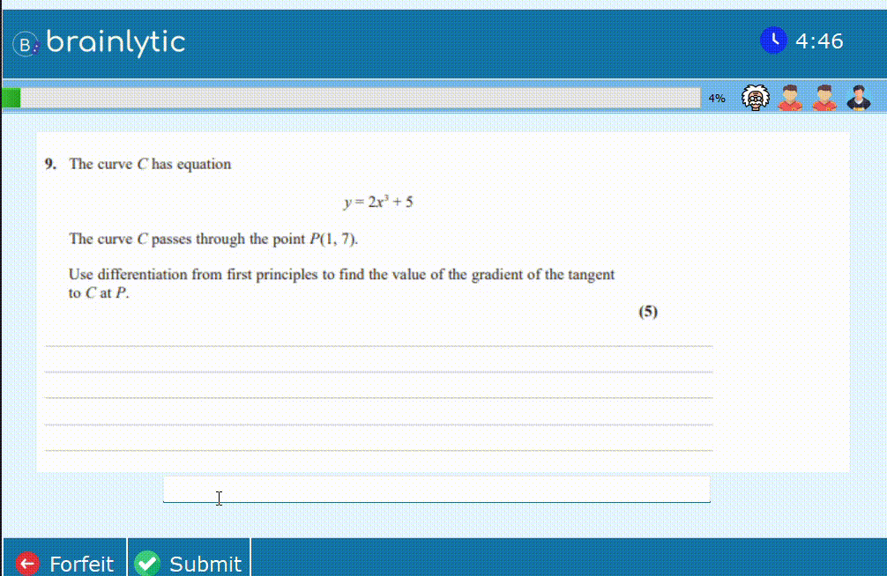
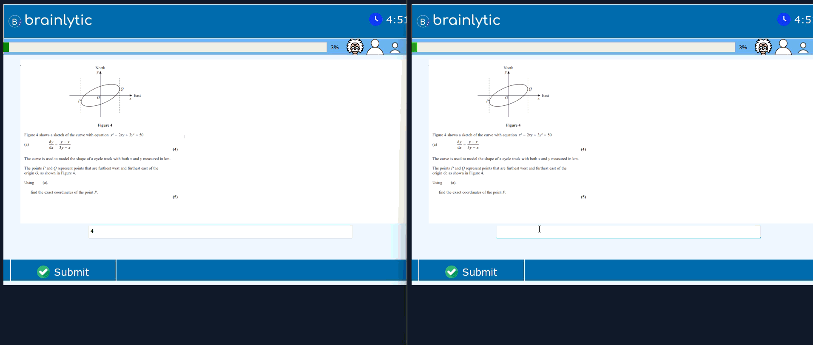
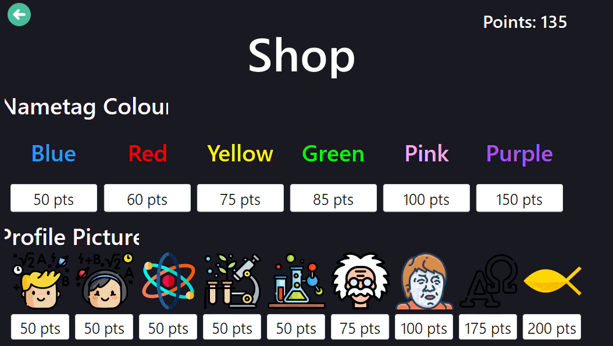
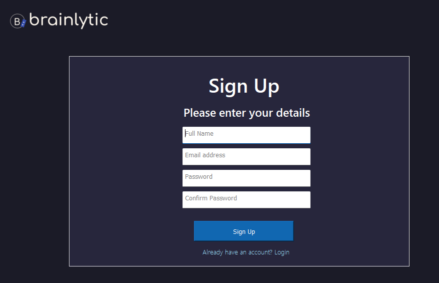
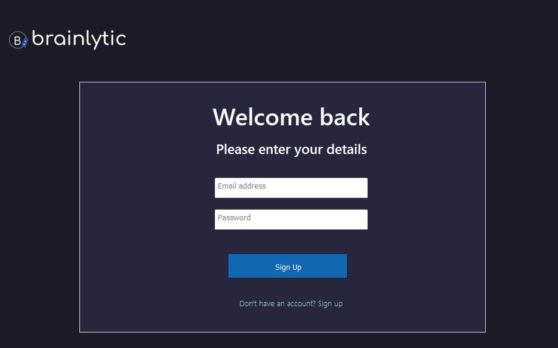
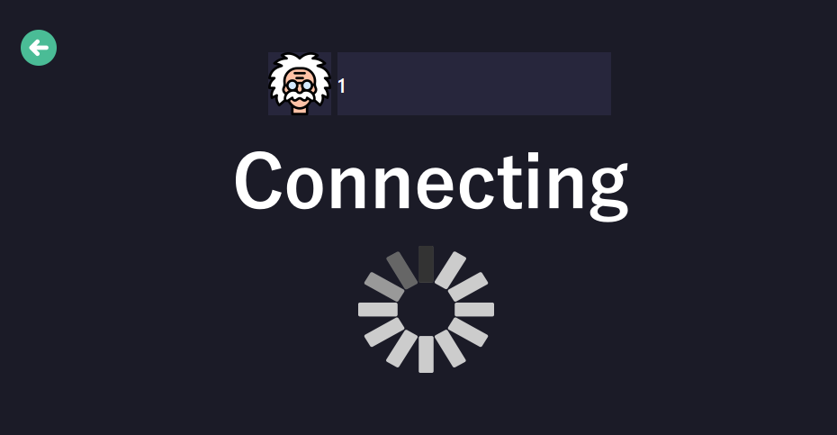
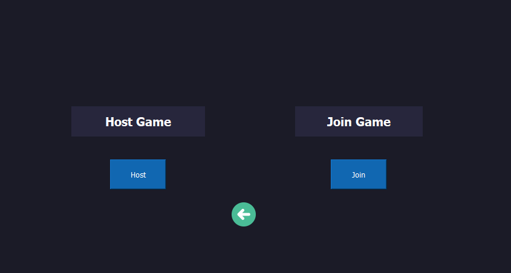
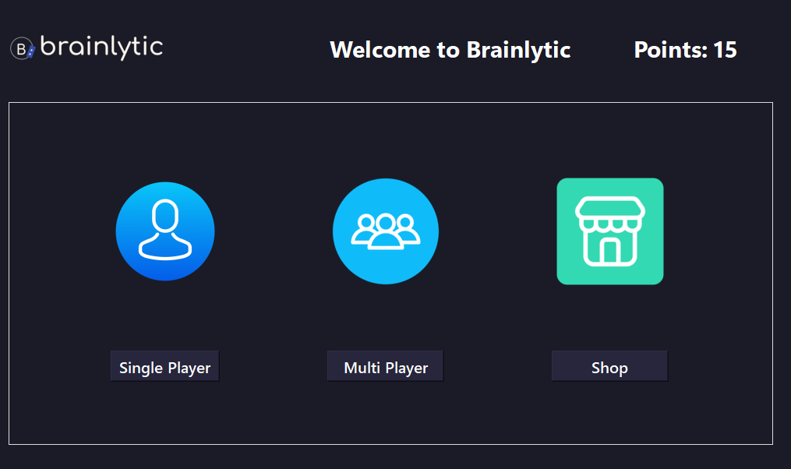
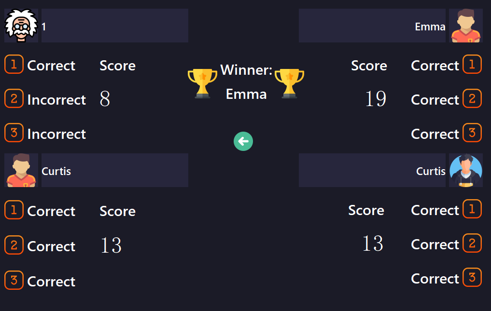

# Brainlytic (A-Level Math Revision Tool)

## Project Overview:

The intended goal of this tool is to supplement A-Level mathematics revision with a fun and intuitive way of learning.

This project is designed for students who are studying under the Edexcel exam board however, those who are enrolled in other exam boards are also welcome to utilise this tool if useful. 

## Features:

### User accounts and Saved Progress

Allows for multiple accounts on one device with each account having their own set of progress and achievements

### Points and Shop System

Allows for users to compete for points and utilise these points for cosmetic upgrades such as name tags or a new profile picture.

### Singleplayer 

Allows for users to compete against bots for rewards. Bots vary by ability which will be notable by their profile picture. Different abilities grant different completion times and changes the probability of them getting a correct answer.

### LAN Multiplayer functionality

Enables users connected to the same network to join the same session and compete. 

### Exam Style Questions

All questions shown are exam style questions in the same style of Edexcel exams.

## Technologies Used:

### PyQT5 

Made using PyQT5 Designer software for the GUI. This creates an aesthetically pleasing environment with soft colours to make text more readable.

### SQLite 3

All data stored is handled using SQLite 3. SQLite was used since this software is run locally without the need for an external database server.

### Hashlib

Passwords are not stored in plaintext. Instead, PBKDF2-HMAC-SHA256 is used, with a unique randomly generated 16-byte salt for each account. Both the salt and resulting hash are stored in the SQLite database and used during subsequent login attempts.

### LAN Networking (Sockets)

This was done via threading and the Python Socket Library. This uses the client-server model where 1 user acts as a host and other users are connected as clients. Any data that a client needs to send to the other clients is handled by the host. The host takes the data and broadcasts it across the network so other devices can update information accordingly. Any data to be sent across the network has a label attached and is converted to json format then converted once more into bytes prior to transmission. This is then converted back into a string when being recieved. Threading is used to create a background while loop which listens for any data sent from the server for clients or data sent from the clients for the host. Threading is necessary to prevent the program from freezing during the execution of the while loop. If an error was to occur such as one of the clients disconnecting or the server being full the other devices have their threads closed and are returned to the main menu. A dialog box is then shown informing them of the reason for being rejected.

## Demonstration

### Singleplayer
Demonstration of the single-player question system and competing against bots.



### LAN Multiplayer

Demonstration of two clients joining a multiplayer session, submitting answers and viewing the results.



### Shop System
Demonstration of the shop, including purchasing, equipping and unequipping cosmetic items.



## Application Screenshots

<table>
  <tr>
    <td align="center">
      <strong>Sign Up</strong><br>
      
    </td>
    <td align="center">
      <strong>Login</strong><br>
      
    </td>
  </tr>
  <tr>
    <td align="center">
      <strong>Connecting</strong><br>
      
    </td>
    <td align="center">
      <strong>Online Selection</strong><br>
      
    </td>
  </tr>
  <tr>
    <td align="center">
      <strong>Home</strong><br>
      
    </td>
    <td align="center">
      <strong>Winner</strong><br>
      
    </td>
  </tr>
</table>

## Limitations and Removed Features

### Fixed window Size

- The GUI is designed around a fixed window size. Its widgets do not dynamically reposition or resize when the application window is expanded.

### Email Verification System

- An email verification system was initially implemented using SMTP, with unique verification codes that expired after 10 minutes. It was subsequently removed because the application was designed around locally managed accounts and did not require email verification.

## Installation & Setup

### Prerequisites & Dependencies

| Module / Dependency | Category | Installation Command / Link | Description |
| :--- | :--- | :--- | :--- |
| **Python 3.x** | Core Engine | [Download Python](https://python.org) | Required to run the application. |
| **PyQt5** | Third-Party | `pip install PyQt5` | Handles the Graphical User Interface (GUI). |

---

### Setup Instructions

1. **Clone the Repository**
   ```bash
   git clone https://github.com
   cd YOUR_REPOSITORY_NAME
   ```

2. **Install Required Packages**
   You only need to install **PyQt5** using pip, as all other network and database utilities are bundled with Python:
   ```bash
   pip install PyQt5
   ```

3. **Verify File Structure**
   Ensure all internal modules (`auth_module.py`, `points_module.py`, `question_module.py`, `ui_main.py`, `protocol.py`, `server.py`, and `clientModule.py`) are placed in the root directory alongside your main execution script.

4. **Run the Application**
   ```bash
   python main.py
   ```
